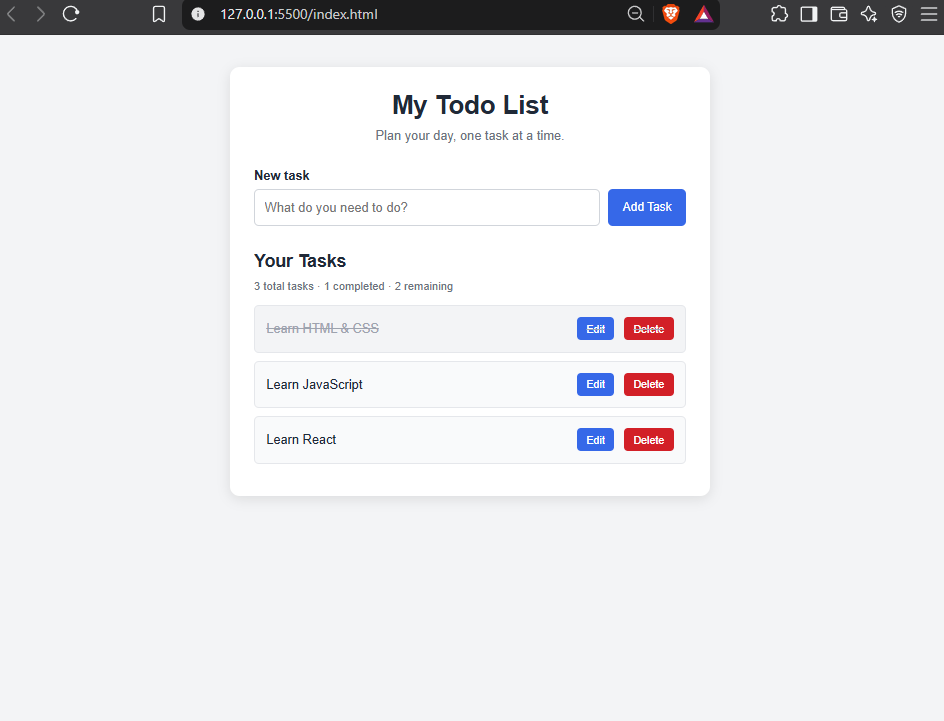

# Todo App

A responsive Todo App built with HTML, CSS, and Vanilla JavaScript. It allows users to manage daily tasks with persistent storage using the browser's Local Storage.

## Live Demo

[Todo App Live Demo Link](https://sktawfiq.github.io/todo-app)

## Preview



## Features

- Add new tasks
- Edit existing tasks
- Delete tasks
- Mark tasks as completed or incomplete
- Display total and completed task counts
- Save tasks using browser Local Storage
- Retain tasks after refreshing the page
- Responsive layout for different screen sizes
- Empty-state message when there are no tasks

## Technologies Used

- HTML5
- CSS3
- JavaScript (Vanilla JS)
- Browser Local Storage

## Getting Started

### Run Locally

1. Clone the repository:

   ```bash
   git clone YOUR_REPOSITORY_URL
   ```

2. Open the project folder.

3. Open `index.html` in your browser.

No additional dependencies or installation are required.

## Project Structure

```text
todo-app/
├── index.html
├── style.css
├── script.js
├── .gitignore
└── README.md
```

## What I Practiced

- DOM manipulation
- JavaScript event handling
- Arrays and objects
- Array methods
- Dynamic HTML element creation
- Form handling and validation
- Local Storage
- JSON serialization and parsing
- Responsive CSS
- Git and GitHub workflow

## Author

**SK Tawfiq Hasib**

- GitHub: [@sktawfiq](https://github.com/sktawfiq)
